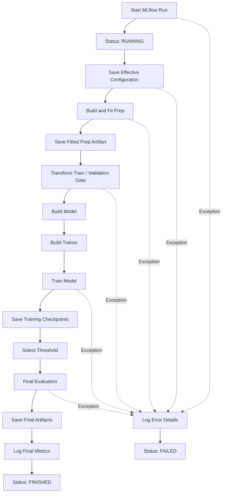

# Experiment Lifecycle

## Overview

An experiment represents a complete, reproducible execution of the anomaly detection pipeline.

MLflow is responsible for tracking the experiment lifecycle, including configuration, preprocessing artifacts, training, checkpoints, final model artifacts, and evaluation metrics.

The `Experiment` / `ExperimentPipeline` orchestration layer coordinates these operations.

## Execution Flow




```text
                    Start MLflow Run
                           |
                           v
                    Status = RUNNING
                           |
                           v
                 Save Effective Configuration
                           |
                           v
                    Build and Fit Prep
                           |
                           v
                   Save Prep Artifact
                           |
                           v
                Transform Train / Validation
                           |
                           v
                      Build Model
                           |
                           v
                     Build Trainer
                           |
                           v
                        Train
                           |
                           v
                  Save Checkpoints
                           |
                           v
                   Select Threshold
                           |
                           v
                   Final Evaluation
                           |
                           v
                  Save Final Artifacts
                           |
                           v
                   Log Final Metrics
                           |
                           v
                   Status = FINISHED


    Any exception during execution
                  |
                  v
           Log Error Details
                  |
                  v
             Status = FAILED
```


## Execution Stages

### 1. Experiment Initialization

- Start an MLflow run.
- Set the run status to `RUNNING`.
- Save the effective configuration.

The effective configuration includes the resolved configurations used by each component:

- Preprocessing
- Model
- Trainer
- Tuning
- Threshold selection

This ensures that an experiment can be reproduced using its actual configuration rather than relying on configuration defaults that might change later.

### 2. Preprocessing

- Build the preprocessing pipeline.
- Fit preprocessing transformations using training data only.
- Save the fitted preprocessing artifact.
- Transform training and validation data.

The fitted preprocessing artifact must be preserved because inference must apply exactly the same transformations used during training.

### 3. Model and Trainer Construction

- Build the model using the model registry.
- Build the trainer using the trainer registry.

Model architecture and training procedure remain independent components.

### 4. Training

- Execute model training.
- Log training metrics.
- Save intermediate checkpoints.

Checkpoints are stored under:

```text
artifacts/
    checkpoints/
```

Checkpoints support training recovery and model selection. They are not necessarily the final inference artifacts.

### 5. Threshold Selection

Select the decision threshold using the configured threshold selection strategy.

The selected threshold is logged independently from the model configuration.

This allows the model to produce anomaly scores independently of the final classification decision.

### 6. Final Evaluation

Evaluate the trained model using the selected threshold.

Log the final evaluation metrics, including relevant classification and anomaly detection metrics.

### 7. Artifact Finalization

Save the artifacts required for reproducible inference:

- Fitted preprocessing pipeline.
- Final model weights and configuration.
- Wrapper configuration and metadata.
- Selected threshold.
- Relevant experiment metadata.

Log final evaluation metrics and complete the MLflow run.

### 8. Experiment Completion

Successful execution:

```text
status = FINISHED
```

Failed execution:

```text
status = FAILED
```

If an exception occurs during any pipeline stage:

- Log relevant error information.
- Mark the MLflow run as failed.
- Preserve available diagnostic information.

## MLflow Responsibilities


```
| Component | Logged information |
|---|---|
| Experiment | Run metadata and tags |
| Configuration | Effective component configurations |
| Preprocessing | Fitted preprocessing artifact |
| Training | Training metrics and history |
| Checkpoints | Intermediate model checkpoints |
| Model | Final weights and model configuration |
| Thresholding | Selected threshold and selection strategy |
| Evaluation | Final evaluation metrics |
```  


## Architectural Principles

### Experiment Orchestration Owns MLflow

MLflow lifecycle management belongs to the experiment orchestration layer (`Experiment` / `ExperimentPipeline`).

Individual components should not be responsible for managing MLflow runs.

Their responsibilities remain independent:

- `BasePrep`: data transformations and preprocessing persistence.
- `BaseModel`: model architecture, input adaptation, scoring and model persistence.
- `BaseTrainer`: model optimization and training.
- `Experiment`: coordinates execution and experiment tracking.

### Checkpoints vs. Final Artifacts

These serve different purposes:

| Checkpoints | Final Artifacts |
|---|---|
| Support training recovery | Support inference |
| May contain intermediate states | Represent the selected final model |
| Primarily training-oriented | Inference-oriented |
| Can be multiple | Usually one finalized artifact set |

### Reproducibility

An experiment should preserve enough information to reproduce its results and reconstruct its inference pipeline.

This includes:

- Effective configuration.
- Fitted preprocessing transformations.
- Model architecture and weights.
- Training information.
- Selected threshold.
- Evaluation results.

The MLflow run acts as the central record connecting these elements.